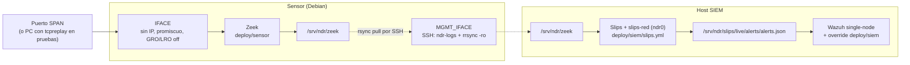

# Despliegue fuera del laboratorio

Dos equipos físicos: el **sensor**, que captura el tráfico espejado con Zeek, y el **host SIEM**, que analiza los logs con Slips y recibe las alertas en Wazuh.



| Ruta | Contenido |
|---|---|
| `deploy/sensor/docker-compose.yml` | Zeek con `network_mode: host` sobre `IFACE` |
| `deploy/sensor/start-zeek.sh` | Inicio de Zeek en el sensor: una carpeta `run-<fecha>` por arranque y filtro de captura opcional |
| `deploy/sensor/privacidad.zeek` | Scripts de la política `local` de la imagen que el sensor no carga (`detect-MHR`) |
| `deploy/sensor/.env.example` | Variables del sensor |
| `deploy/siem/slips.yml` | Slips y el contenedor `slips-red`, que crea `ndr0` |
| `deploy/siem/docker-compose.yml` | Override del compose single-node oficial de wazuh-docker |
| `deploy/siem/.env.example` | Variables del host SIEM, compartidas por los dos compose |
| `scripts/sensor-init-test/sensor-prep.sh` | Preparación del sensor |

## Diferencias con el diseño en Kubernetes

En `k8s/` y `docs/diseno/TD06-despliegue-kubernetes.md`, Slips corre en el mismo nodo que Zeek y envía las alertas a Wazuh mediante un agente. Aquí Slips corre en el host SIEM:

- Los logs de Zeek cruzan la red (rsync) en vez de compartirse en disco local.
- El manager de Wazuh lee `alerts.json` desde una carpeta local, igual que en el laboratorio, por lo que no hace falta agente.
- El sensor (ThinkCentre M73) tiene 8 GB de RAM. Los límites de memoria de Zeek (6 GB en `deploy/sensor`) y de Slips (8 GiB en `k8s/30-slips.yaml`) no caben juntos en ese equipo.

## Transporte de logs: rsync desde el SIEM

El host SIEM trae los logs (pull); el sensor no los envía.

- El sensor no guarda credenciales del SIEM. Si se cae la red, Zeek sigue escribiendo en su disco y el SIEM se pone al día en la siguiente copia.
- La llave del SIEM queda limitada en `authorized_keys` con `restrict` (sin terminal ni reenvíos) y `command="rrsync -ro LOGS_DIR"`: cualquier comando que pida el SIEM se reemplaza por rsync de solo lectura sobre la carpeta de logs (`man rrsync`, `man sshd`, sección AUTHORIZED_KEYS FILE FORMAT).
- `--append` agrega al final de los archivos ya copiados sin reemplazarlos. El archivo conserva su inode, que es lo que necesita Slips para seguir leyendo un log que crece (`-g`).
- La ruta remota es `:.` y no `:/`. rrsync 3.5.0 rechaza `/` con `unsafe arg`.

```bash
rsync -rlt --append -e "ssh -i ~/.ssh/id_ed25519_ndr" ndr-logs@<IP-gestion-sensor>:. /srv/ndr/zeek/
```

Comprobado en local (rsync 3.5.0, 2026-11-02) simulando el comando forzado: la copia conserva el enlace `current` y el mismo inode tras una segunda pasada; rrsync rechaza escribir en el sensor (`sending to read-only server is not allowed`) y la opción `--remove-source-files`.

## Sensor

### Variables (`deploy/sensor/.env`)

| Variable | Uso |
|---|---|
| `IFACE` | NIC que recibe el tráfico espejado. Queda sin IP ni IPv6, en modo promiscuo y con GRO/LRO desactivados |
| `MGMT_IFACE` | NIC de administración y de salida de los logs. Si está definida, `IFACE` pierde su IP al reiniciar |
| `LOGS_DIR` | Carpeta de los logs de Zeek (`/srv/ndr/zeek`) |
| `RETENCION_DIAS` | Días que se conservan los logs (30, igual que `k8s/40-retencion.yaml`) |
| `SIEM_PUBKEY` | Llave pública SSH del host SIEM (`deploy/sensor/siem.pub`, ignorada por git) |
| `FILTRO_CAPTURA` | Filtro BPF opcional que Zeek recibe con `-f`. Vacío: captura todo. Ej.: `not host <IP de gestión del sensor>` |

### Pasos

El paso 8 le quita la IP a `IFACE`. Si `MGMT_IFACE` no tiene una estrofa `iface` propia (en `/etc/network/interfaces` o en otro archivo de `interfaces.d/`), el script le asigna DHCP en `/etc/network/interfaces.d/ndr-gestion`. Así el sensor no queda sin SSH al invertir los roles, por ejemplo con el adaptador USB como gestión y `enp2s0` como captura. Si la gestión necesita IP estática, hay que configurarla antes de ejecutar el script.

```bash
cp deploy/sensor/.env.example deploy/sensor/.env    # completar IFACE y MGMT_IFACE
# Desde el SIEM: scp ~/.ssh/id_ed25519_ndr.pub <usuario>@<sensor>:<repo>/deploy/sensor/siem.pub
sudo ./scripts/sensor-init-test/sensor-prep.sh
sudo reboot                                         # el paso 8 se aplica al reiniciar
```

El script hace, en orden:

1. Paquetes base, incluidos `rsync`, `python3` (rrsync es un script de python) y `openssh-server`.
2. Repositorio oficial de Docker (https://docs.docker.com/engine/install/debian/).
3. Docker Engine y Compose.
4. Servicio `ndr-nic-captura`, que desactiva GRO y LRO cada vez que aparece `IFACE`, también si es USB.
5. Carpeta de logs e imagen de Zeek.
6. Timer `ndr-retencion-zeek` (03:30): borra logs con más de `RETENCION_DIAS` días y las carpetas `run-*` vacías.
7. Usuario `ndr-logs` con la llave del SIEM restringida a `rrsync -ro`. Se omite si falta `siem.pub`.
8. `IFACE` sin IP, IPv6 ni DHCP en `/etc/network/interfaces.d/ndr-captura`, y DHCP para `MGMT_IFACE` en `ndr-gestion` si no tiene configuración propia. Se omite si `MGMT_IFACE` está vacía.

Después del reinicio:

```bash
ip -br addr show <IFACE>                                        # sin IP
ip -d link show <IFACE> | grep -o 'promiscuity [0-9]*'          # 1
ethtool -k <IFACE> | grep -E 'generic-receive|large-receive'    # off
cat /proc/sys/net/ipv6/conf/<IFACE>/disable_ipv6                # 1
systemctl is-active ndr-nic-captura.service ndr-retencion-zeek.timer
cd deploy/sensor && sudo docker compose up -d
ls -l /srv/ndr/zeek/current                                     # apunta a un run-<fecha> nuevo
cat /srv/ndr/zeek/current/packet_filter.log                     # el filtro de FILTRO_CAPTURA
grep -c detect-MHR /srv/ndr/zeek/current/loaded_scripts.log     # 0
```

### Migración desde `deploy/docker-compose.yml`

El compose del sensor estuvo antes en `deploy/`. En un sensor que lo usaba:

1. `cd deploy && sudo docker compose down` **antes** del `git pull`. El pull borra ese archivo y el contenedor anterior tiene `restart: unless-stopped`.
2. `git pull`.
3. Mover `deploy/.env` a `deploy/sensor/.env`: está ignorado por git y el pull no lo mueve.
4. Mover los logs de pruebas anteriores fuera de `LOGS_DIR`; el SIEM copiaría todo lo que haya ahí.

## Host SIEM

Todavía no hay script de preparación; estos pasos son los que debería automatizar.

```bash
cp deploy/siem/.env.example deploy/siem/.env        # NDR_DIR, RED_LOCAL, ZEEK_LOGS, SLIPS_DIR

sudo modprobe dummy                                 # slips-red crea ndr0; un contenedor no puede cargar el modulo
sudo sysctl -w vm.max_map_count=262144              # indexer de Wazuh; persistir en /etc/sysctl.d/
sudo mkdir -p /srv/ndr/zeek /srv/ndr/slips/live/alerts
sudo chown -R "$USER": /srv/ndr/zeek                # rsync corre con el usuario
sudo touch /srv/ndr/slips/live/alerts/alerts.json   # debe existir antes de levantar Wazuh

ssh-keygen -t ed25519 -f ~/.ssh/id_ed25519_ndr -C "ndr-siem"
ssh -i ~/.ssh/id_ed25519_ndr ndr-logs@<IP-gestion-sensor>    # una vez, para aceptar la huella
```

`RED_LOCAL` es la dirección que recibe `ndr0`, en CIDR. Con `-g`, Slips toma la red local de la interfaz de `-i` e ignora `client_ips`. Debe ser una IP libre del segmento vigilado, porque Slips trata la IP de su interfaz como propia. Para CIC-IDS2017: `192.168.10.254/24`.

### Wazuh

El override se ejecuta desde `wazuh-docker/single-node/`, así que no lee `deploy/siem/.env` por su cuenta: se le pasa con `--env-file` para que use el mismo `SLIPS_DIR` que Slips.

```bash
cd wazuh-docker/single-node
cp ../../deploy/siem/docker-compose.yml docker-compose.override.yml
docker compose --env-file ../../deploy/siem/.env up -d
```

En un equipo que también corre el laboratorio, el Wazuh del laboratorio usa el mismo nombre de proyecto (`single-node`) y los mismos puertos. Hay que bajarlo antes (`docker compose down`, sin `-v` para conservar los datos) y respaldar su override, y luego destruir el laboratorio. En ese orden, porque el manager del laboratorio está conectado a la red `clab-ndr-mgmt`.

### Logs y Slips

Mientras no exista un timer, la copia se hace con un bucle en una terminal aparte:

```bash
while true; do
  rsync -rlt --append -e "ssh -i ~/.ssh/id_ed25519_ndr" ndr-logs@<IP-gestion-sensor>:. /srv/ndr/zeek/
  sleep 15
done
```

Slips se levanta cuando ya llegó `/srv/ndr/zeek/current`:

```bash
cd deploy/siem && docker compose -f slips.yml up -d
docker compose -f slips.yml logs slips | grep -i "local net"    # debe mostrar la red de RED_LOCAL en ndr0
```

### Verificación

```bash
wc -l /srv/ndr/zeek/current/*.log                   # comparar con lo mismo en el sensor tras la ultima copia
wc -l /srv/ndr/slips/live/alerts/alerts.json
docker exec single-node-wazuh.manager-1 grep -o '"id":"1002[0-9][0-9]"' /var/ossec/logs/alerts/alerts.json | sort | uniq -c
```

## Pruebas con pcap

Un PC reemplaza al switch: reproduce el pcap con tcpreplay por un cable directo hacia `IFACE`.

En el PC que reenvía:

```bash
sudo nmcli device set <nic> managed no                  # si no, NetworkManager pide DHCP y baja el enlace cada ~52 s
sudo sysctl -w net.ipv6.conf.<nic>.disable_ipv6=1       # sin anuncios IPv6 propios en la captura
sudo ip link set <nic> up
sudo tcpreplay -i <nic> --preload-pcap --multiplier=<N> --stats=60 <archivo.pcap>
```

- **Superpaquetes.** Los pcap de CIC-IDS2017 se capturaron con offloads activos y traen paquetes de 1515 a ~3100 bytes. No son jumbo frames: son paquetes que la NIC de captura juntó. Para enviarlos sin filtrar, los dos extremos del cable necesitan MTU 9000 (`ip -d link show <nic> | grep maxmtu`). Si alguno no lo admite, se usa el pcap filtrado (`'greater 14 and less 1514'`), que pierde el 55 % de los bytes y rompe flujos TCP, o se prueba dentro del sensor con un par veth de MTU 9000. El MTU 9000 es un ajuste de la prueba, no del despliegue: un SPAN real entrega tramas de hasta 1500 bytes.
- **Capacidad y detección son pruebas distintas.** Para capacidad sirve comprimir el tiempo (x50). Para detección no: con x50, una pausa de 5 min dura 6 s, Zeek junta conexiones que deberían expirar y las ventanas de tiempo de Slips se comprimen. La detección se prueba a x1, recortando el pcap a las ventanas de ataque con `editcap -A/-B`, o con `zeek -r`, que conserva los timestamps originales.
- **Dónde se ven las pérdidas.** Si el enlace es más lento que la tasa pedida, el exceso no se descarta en el sensor: frena a tcpreplay, que no alcanza la tasa y tarda más. Hay que mirar la tasa real de tcpreplay, los contadores de la NIC (`ip -s link`: dropped, missed) y `pkts_dropped` en `stats.log` de Zeek.
- **Etiquetas.** `MachineLearningCSV.zip` no trae IP ni timestamps. Para cruzar alertas con la verdad del dataset se necesita `GeneratedLabelledFlows.zip` (TrafficLabelling). Esas etiquetas tienen errores conocidos (Engelen et al., 2021, *Troubleshooting an Intrusion Detection Dataset: the CICIDS2017 Case Study*).
- **Descarga.** Las URL directas de los pcap redirigen al formulario de registro de UNB y devuelven HTML (comprobado el 2026-11-02). La URL de descarga se obtiene completando el formulario.

## Limitaciones conocidas

- **El adaptador USB ASIX AX88772B no sirve para captura.** Es USB 2.0 y Ethernet 10/100: un SPAN de más de 100 Mbps pierde el exceso en el switch. Sirve como interfaz de gestión.
- **Slips resuelve `current` una sola vez, al arrancar.** Si Zeek se reinicia, crea un `run-<fecha>` nuevo y hay que reiniciar Slips.
- **Un reinicio de Slips duplica alertas en Wazuh.** Slips borra `alerts.json` al arrancar y vuelve a leer la carpeta de Zeek desde el principio.
- **Zeek no rota sus logs.** El timer de retención no borra un archivo en uso, así que cada log crece mientras Zeek no se reinicie.
- **La copia de logs es manual.** Falta el timer de rsync en el host SIEM.
- **Con `FILTRO_CAPTURA=not host <IP de gestión>`, el sensor no se vigila a sí mismo.** Si el propio sensor genera tráfico malicioso, el NDR no lo ve.
- **El filtro por IP solo cubre IPv4 y ARP.** El tráfico IPv6 de la NIC de gestión, si lo hay, se sigue registrando.
- **`configs/wazuh/ossec.conf` incluye la respuesta activa `ndr-bloqueo` del laboratorio.** Sin un agente en el firewall no tiene efecto.
